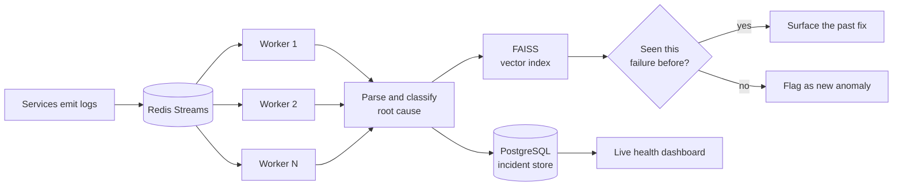

<div align="center">


# Kush Agarwal

<h2>I build backend systems that scale horizontally.</h2>

<b>Redis Streams &nbsp;·&nbsp; FastAPI &nbsp;·&nbsp; PostgreSQL &nbsp;·&nbsp; Docker &nbsp;·&nbsp; AWS</b>

540+ DSA problems &nbsp;·&nbsp; LeetCode Knight (1938) &nbsp;·&nbsp; Open to Software Engineering internships

<br/>

<a href="https://www.linkedin.com/in/kushagarwal0805/"></a>
<a href="https://leetcode.com/u/kush0809/"></a>
<a href="https://portfolio-seven-topaz-6oy3w9tofj.vercel.app/"></a>
<a href="mailto:kushagarwal0805@gmail.com"></a>


</div>

---

## About me

```python
class KushAgarwal:
    role       = "Backend Engineer (in training)"
    education  = "B.Tech CSE (AI) @ NIET Noida  ·  2023–2027  ·  CGPA 8.66"
    focus      = ["distributed systems", "REST API design", "data pipelines"]
    stack      = ["Python", "FastAPI", "Redis", "PostgreSQL", "Docker", "AWS"]
    dsa        = {"solved": "540+", "rank": "Knight", "rating": 1938}
    currently  = "Looking for a Software Engineering internship"
```

- Won the **Grand Prize at Contata NCR Hackathon 2026** for a DAG scheduling engine that propagates a schedule slip through 1,000 tasks in **under 1 ms**, at 94% test coverage across 600 property-based graph cases
- Engineered a **Redis Streams** log-ingestion pipeline that scales horizontally across consumer groups
- Cut simulated portfolio drawdown by **59%** with a FAISS-powered recommendation engine
- Hit **100% job completion at 6 jobs/sec** across 3 concurrent Dockerized workers
- **Top 10 of 120+ teams** at HackO'Clock, a national-level hackathon
- Previously **Python Developer @ LetsGrowMore** — automation with Pandas and Flask

---

## Tech stack

**Languages**


**Backend & infrastructure**


**Data**


**Frontend & tooling**


---

## Featured work

<table>
<tr>
<td width="50%" valign="top">

### TaskFlow Pro — DAG Scheduling Engine
🏆 **Grand Prize — Contata NCR Hackathon 2026**
`Python` `FastAPI` `React` `TypeScript` `PostgreSQL` `Docker`

A Kanban board that understands dependencies. A pure graph engine, isolated from the web and database layers, derives Blocked/Ready state from the DAG on every read, rejects links that would create a cycle, and propagates schedule slips downstream without double-counting shared paths. Critical-path detection highlights the zero-slack chain. PostgreSQL advisory locks handle multi-process concurrency.

**→ Propagates a delay through 1,000 tasks in under 1 ms. 61 backend tests at 94% coverage, with 600 randomly generated graphs checked by property-based tests.**

[](https://github.com/MARCIZOS/taskflow-pro)

</td>
<td width="50%" valign="top">

### AI Log Analyzer & RCA Tool
`Python` `FastAPI` `Redis Streams` `PostgreSQL` `FAISS` `Docker`

A Dockerized log-ingestion pipeline built on Redis Streams that scales horizontally across consumer groups. Classifies root causes automatically through a unit-tested parsing pipeline and surfaces past incidents via FAISS similarity search, with live dashboards for infrastructure health.

**→ Cuts manual debugging time by surfacing the matching past incident instead of the raw log.**

[](https://github.com/MARCIZOS/log_analyzer)

</td>
</tr>
<tr>
<td width="50%" valign="top">

### ARAIA — Portfolio Diversification
`Python` `FastAPI` `React` `FAISS` `scikit-learn` `AWS`

A full-stack risk-analytics platform that stress-tests portfolios against macroeconomic scenarios. Versioned, unit-tested REST APIs in FastAPI, a React front end, and a FAISS recommendation engine for diversification under stress. Deployed on AWS EC2 + S3.

**→ Reduced simulated portfolio drawdown by 59%.**

[](https://d25kw1rc4w7fmu.cloudfront.net/) [](https://github.com/MARCIZOS/portfolio_diversification)

</td>
<td width="50%" valign="top">

### HealGrid — Telehealth Platform
`React` `TypeScript` `Firebase` `WebRTC` `Tailwind`

A telehealth app with Firebase auth and Firestore, peer-to-peer WebRTC video consultations, a multi-language interface, and a separate Node API service deployed on Render.

**→ Doctor and patient hold a live consultation in the browser — no plugin, no third-party call service.**

[](https://github.com/MARCIZOS/heal-grid)

</td>
</tr>
<tr>
<td width="50%" valign="top">

### FairFix — Service Bill Auditor
`Python` `Nemotron` `Nebius` `OCR`

Reads a vehicle service bill and estimate line by line, checks each item against the official service schedule, comparable part prices and recall data, and drafts a neutral question for the service advisor. Every result shows the rule and the evidence behind it.

**→ When it cannot verify a line, it says so instead of guessing.**

[](https://github.com/MARCIZOS/fairfix)

</td>
<td width="50%" valign="top">

### AI Exam Generator
`Node.js` `Express` `OCR` `Groq vision`

Generates and grades exam papers from uploaded source material. OCR pulls text out of scanned documents — including handwriting, via a vision model — an LLM service drafts the questions, and an evaluator scores submitted answers.

**→ Turns a scanned syllabus into a graded question paper end to end.**

[](https://ai-exam-generator-plum.vercel.app) [](https://github.com/MARCIZOS/ai_exam_generator)

</td>
</tr>
</table>

---

## How I think about systems

The architecture behind the log analyzer — a Redis Streams pipeline that scales by adding consumers, not by scaling up:



Add a consumer, throughput goes up. No coordinator to fall over, no single worker to bottleneck on.

---

## By the numbers

<div align="center">


</div>

| | |
|---|---|
| **59%** | reduction in simulated portfolio drawdown, via FAISS-based diversification |
| **6 jobs/sec** | sustained at 100% completion across 3 concurrent Dockerized workers |
| **540+** | DSA problems solved, LeetCode Knight at 1938 |
| **Grand Prize** | Contata NCR Hackathon 2026 (PS-01) — TaskFlow Pro |
| **Top 10** | of 120+ teams at HackO'Clock, a national-level hackathon |

## Let's talk

I'm looking for a **Software Engineering / Backend internship** where I can work on systems that have real load behind them. If that's something you're hiring for, I'd like to hear from you.

<div align="center">

<a href="mailto:kushagarwal0805@gmail.com"></a>
<a href="https://www.linkedin.com/in/kushagarwal0805/"></a>

<br/><br/>

<i>"The best way to learn distributed systems is to break one at 6 jobs per second."</i>


</div>
