

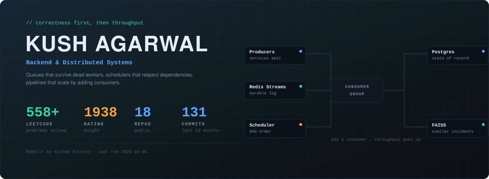

<a href="https://portfolio-marcizos-projects.vercel.app"></a>
<a href="https://www.linkedin.com/in/kushagarwal0805/"></a>
<a href="https://leetcode.com/u/kush0809/"></a>

 

## Featured work

<table>
<tr>
<td width="50%"><a href="https://github.com/MARCIZOS/taskflow-pro"></a></td>
<td width="50%"><a href="https://github.com/MARCIZOS/portfolio_diversification">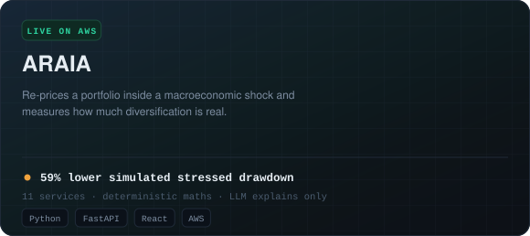</a></td>
</tr>
<tr>
<td width="50%"><a href="https://github.com/MARCIZOS/log_analyzer"></a></td>
<td width="50%"><a href="https://github.com/MARCIZOS/fairfix"></a></td>
</tr>
<tr>
<td width="50%"><a href="https://github.com/MARCIZOS/ai_exam_generator"></a></td>
<td width="50%"><a href="https://github.com/MARCIZOS/Rank-Radar"></a></td>
</tr>
</table>

## Live


## The year, replayed


## How I think about systems

The architecture behind the log analyzer — a Redis Streams pipeline that scales by adding consumers, not by scaling up:

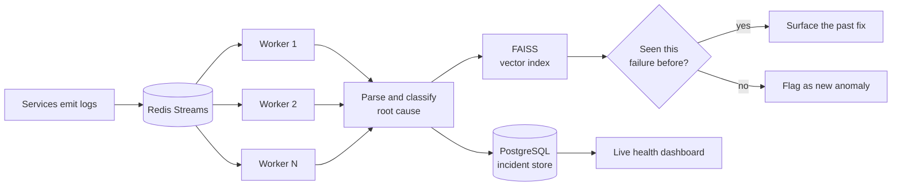

No coordinator to fall over, no single worker to bottleneck on.

## By the numbers


## Let's talk

I'm looking for a **Software Engineering / Backend internship** where I can work on systems that have real load behind them.

Every panel here is generated by a GitHub Action and committed to this repo — no third-party badge services, nothing to rate-limit, nothing to go stale. Last rebuilt 2026-10-30.

