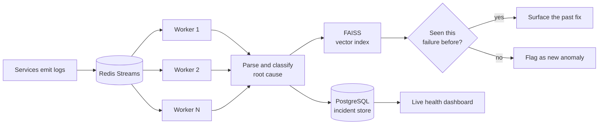

 

## Featured work

<table>
<tr>
<td width="50%"></td>
<td width="50%"></td>
</tr>
<tr>
<td width="50%"></td>
<td width="50%"></td>
</tr>
<tr>
<td width="50%"></td>
<td width="50%"></td>
</tr>
</table>

## Live

## The year, replayed

## How I think about systems

The architecture behind the log analyzer — a Redis Streams pipeline that scales by adding consumers, not by scaling up:

No coordinator to fall over, no single worker to bottleneck on.

## By the numbers

| | |
|---|---|
| **Grand Prize** | Contata NCR Hackathon 2026 (PS-01) — TaskFlow Pro |
| **< 1 ms** | to propagate a delay through 1,000 tasks, at 94% test coverage |
| **59%** | reduction in simulated stressed drawdown (ARAIA) |
| **558+** | DSA problems solved · LeetCode Knight at 1938 |
| **Top 10** | of 120+ teams at HackO'Clock, a national-level hackathon |

## Let's talk

I'm looking for a **Software Engineering / Backend internship** where I can work on systems that have real load behind them.

Hero, cards and scoreboard are generated by a GitHub Action and committed to this repo — no third-party badge services, nothing to rate-limit. Last rebuilt 2026-10-29.

